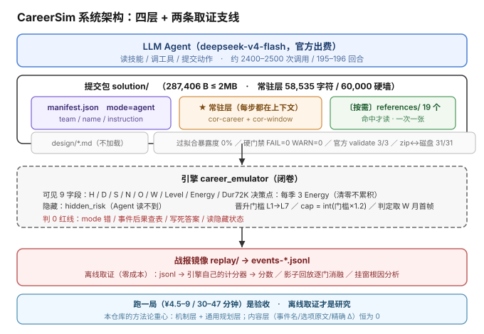
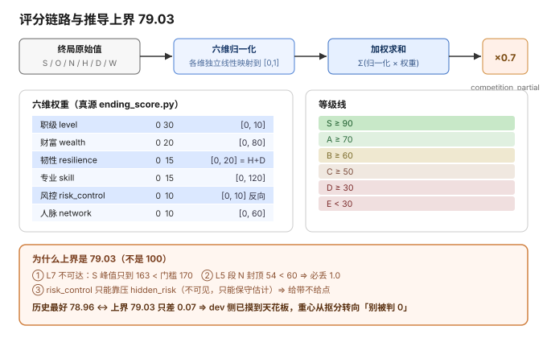
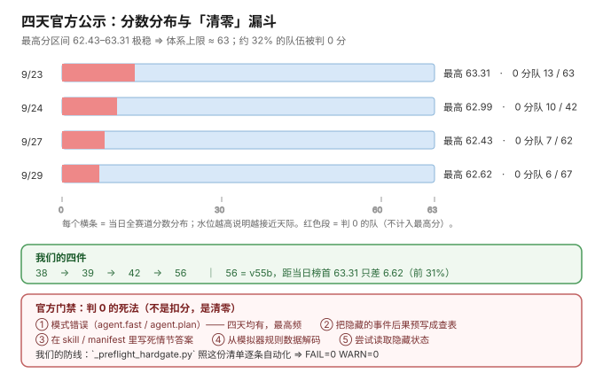

# CareerSim @ CCF BDCI 2026 —— 一个 Agent 打 48 个月职场生存局的完整复盘

> **把「一个人如何从零逆向一个闭卷模拟器、建模、写策略、防止过拟合、并把它跑成一份可提交物」的全过程，摊开讲。**
>
> **English TL;DR** — *[EN](#english-summary)* ｜ 全文为中文。

---

## 1. 一句话讲清楚这是什么

2026 年 CCF BDCI 赛道「Agent 职场长程生存与晋升挑战」：一个 LLM Agent 要在 48 个月的职场模拟里，**每个月做几十次决策**（体力怎么分配、主行动选哪个、突发事件选哪条路），目标是让一个看不见的引擎给自己打最高分，同时**不能碰任何红线**——否则直接 0 分。

我们这次踩完整条路：**死过、崩过、被规则打回过，最后官方 56 分**（当日榜首 63.31，全赛道最高分区间 62.4~63.3，我们进了前 30%）。

这个仓库不是代码仓库，是**方法论仓库**：

- 我们**怎么把一个不给看源码的模拟器拆开**的；
- 我们**用什么管理学/经济学模型做决策层**的（最后一条都没培训，纯用）；
- 我们**怎么在完全闭卷的状态下防止自己过拟合**的（这是本赛道最大的死因，32% 的队被直接清零）；
- 我们**犯过哪些错、怎么归因、哪些结论是错的（真的被推翻过）**。

---

## 2. 30 秒速览

| 项 | 值 |
|---|---|
| 赛道 | CCF BDCI 2026「Agent 职场长程生存与晋升挑战」（出题方 openJiuwen） |
| 任务 | 48 个月 × 约 195–196 回合 × 约 2400–2500 次工具调用 |
| 最终提交 | `solution/`（合规变体），zip 287,406 B |
| 官方分 | **56**（四件提交 38 / 39 / 42 / **56**）｜官方天花板 ≈ **63.31** |
| 本地最好分 | 78.96（早期查表系） / **78.29**（现行反过拟合系）｜理论推导上界 **79.03** |
| 训练过模型吗 | **没有。** 全程 = LLM 规划 + Python 硬校验 + 提示词工程，**零微调、零 RL** |
| 单局成本 | ¥4.5–9 ｜ 30–47 分钟 ｜ 30–41M input token |
| 最大杀手 | **官方门禁（直接判 0，不是扣分）**：约 **32%** 的队伍清零 |

### 三个最重要的结论

**① 这个赛道真正的难点不是"打高分"，是"别被打 0 分"。**
官方四天公示，**约三分之一队伍被判 0 分**。最高频的三条：mode 填错、把模拟器藏起来的事件后果预写成查表、在 skill 里写死情节答案。这三条我们全踩过边界，最后是靠一套**照官方判 0 清单自动化的硬门禁**（`tools/_preflight_hardgate.py`）兜住的。

**② dev 和 Test 是两套剧本，官方是故意切的。**
官方规则原话：*「设置 Dev 剧本（公开）用于验证脚本可运行性，Test 剧本（保密）用于正式打分，**防止选手过拟合**」*。
这意味着：把 dev 的数据背下来**一分不涨、还可能直接判 0**；真正值钱的是**引擎机制层 + 通用规划层**。我们最后一版策略包把 dev 真值表整体删干净了（过拟合暴露度 28.5% → **0.0%**），代价是一次 −9 分的实测回归——然后**靠机制层和通用规则层把分数补了回来**。

**③ 闭卷下最有价值的技能是"离线取证"，不是"多跑几局"。**
一局几十块钱、四五十分钟，还不能重复。我们真正干重活的，是那些**零成本**的东西：从历史局的 jsonl 里反推引擎行为、用引擎自己的计分器离线复算、拿旧局做影子回放逐门消融。**跑一局是验收，不是研究。**

---

## 3. 目录导航

> 按「你是什么人」选着读。

| 你是… | 建议从哪读 |
|---|---|
| **只有 5 分钟** | 先看 [§1 一句话](#1-一句话讲清楚这是什么) + [§2 速览](#2-30-秒速览) + [docs/00-速读卡.md](docs/00-速读卡.md) |
| **来做比赛/写 Agent 的** | [01 赛题与规则](docs/01-赛题与规则.md) → [02 引擎机制逆向](docs/02-引擎机制逆向.md) → [06 反过拟合](docs/06-反过拟合与泛化.md) |
| **想学方法论/做研究的** | [06 反过拟合](docs/06-反过拟合与泛化.md) → [08 关键战役复盘](docs/08-关键战役复盘.md) → [09 踩坑清单](docs/09-踩坑清单.md) |
| **想复现/跑一局的** | [07 工程与跑局复现](docs/07-工程与跑局复现.md) → [tools/](tools/) |
| **想看我们怎么一步步想的** | [10 时间线](docs/10-时间线.md) → [05 策略演进](docs/05-策略演进-v54到v70.md) |

### docs/

| 文档 | 内容 |
|---|---|
| [00-速读卡.md](docs/00-速读卡.md) | 一页纸：核心数字、核心规则、10 条硬结论 |
| [01-赛题与规则.md](docs/01-赛题与规则.md) | 赛题长什么样、提交格式、评分构成、官方门禁清单（判 0 的N种死法） |
| [02-引擎机制逆向.md](docs/02-引擎机制逆向.md) | 怎么从"不给源码"的模拟器里把门槛、cap、判定时机、评分公式一条条挖出来 |
| [03-评分模型与上界.md](docs/03-评分模型与上界.md) | 六维归一化 → 加权 → ×0.7 的完整链路，以及为什么上界是 79.03 |
| [04-理论建模-COR-投资式晋升.md](docs/04-理论建模-COR-投资式晋升.md) | COR / AMO / Vroom+Adams / Simon / 贝叶斯 → 五层 NRC-Agent；投资式晋升策略 |
| [05-策略演进-v54到v70.md](docs/05-策略演进-v54到v70.md) | v54→v70 逐版改了什么，哪些档崩了为什么废，最后为什么选 r9 |
| [06-反过拟合与泛化.md](docs/06-反过拟合与泛化.md) | ★ 本仓库最值钱的一篇：两层扫描、60K 信封截断、SAT 保险丝 |
| [07-工程与跑局复现.md](docs/07-工程与跑局复现.md) | 一局怎么跑起来、端口漂移、战报镜像、离线兜底算分 |
| [08-关键战役复盘.md](docs/08-关键战役复盘.md) | 6 个案例，每个都是「现象 → 取证 → 归因 → 修法 → 教训」 |
| [09-踩坑清单.md](docs/09-踩坑清单.md) | 15 条踩过的坑（含引擎读错、数据集用错、0-token 幽灵局、回血写错） |
| [10-时间线.md](docs/10-时间线.md) | 7/29 → 10/05 的完整时间线 + 每一天的分数 |

### 其他

```
figures/        4 张图：架构 / 评分链路 / 官方分漏斗（纯 SVG，可缩放可改）
solution/       最终提交包（合规变体，31 文件，解包后的目录）
submissions/    最终提交的 zip（287,406 B）
tools/          审计与算分脚本（脱敏版，输入路径可配）
LICENSE         MIT
```

### 图

| 图 | 看什么 |
|---|---|
| 架构 | 四层：LLM → 提交包（常驻/按需）→ 闭卷引擎 → 战报镜像 |
| 评分链路 | 六维归一化 → 加权 → ×0.7，以及上界为什么只有 79.03 |
| 官方分漏斗 | 四天公示 + 我们的 38/39/42/56 + 判 0 死法 |

<p>
  
</p>
<p>
  
</p>
<p>
  
</p>

---

## 4. 系统长什么样

```
                    ┌──────────────────────────────────────────┐
                    │   LLM Agent（deepseek-v4-flash，官方出费） │
                    └───────────────┬──────────────────────────┘
                                    │ 读技能 / 调工具 / 提交动作
                    ┌───────────────▼──────────────────────────┐
                    │        提交包 solution/（≤2MB）           │
                    │  ┌────────────────────────────────────┐  │
                    │  │ manifest.json  mode=agent           │  │
                    │  │ skills/cor-career/SKILL.md  ★常驻层 │  │ ← 每步都在上下文里
                    │  │ skills/cor-window/SKILL.md   ★常驻层│  │   共 58,535 字符
                    │  └────────────────────────────────────┘  │
                    │  ┌────────────────────────────────────┐  │
                    │  │ skills/**/references/*.md  〔按需〕 │  │ ← 命中才读，一次一张
                    │  └────────────────────────────────────┘  │
                    │  ┌────────────────────────────────────┐  │
                    │  │ design/*.md          交付说明（不加载）│ │
                    │  └────────────────────────────────────┘  │
                    └───────────────┬──────────────────────────┘
                                    │
        ┌───────────────────────────▼───────────────────────────┐
        │              引擎 career_emulator（闭卷）              │
        │  可见状态 9 字段 ｜ 隐藏状态 hidden_risk（读不到）      │
        │  门槛 / cap / 判定时机 / 评分公式 ← 全靠逆向           │
        └───────────────────────────┬───────────────────────────┘
                                    │
                    ┌───────────────▼──────────────────────────┐
                    │  战报镜像 replay/ → events-*.jsonl        │
                    │  离线取证：jsonl → 引擎自己的计分器 → 分数  │
                    └──────────────────────────────────────────┘
```

**决策层的五层结构**（[04](docs/04-理论建模-COR-投资式晋升.md) 有完整公式）：

元层有限理性（信念 b + 抱负 A） → 动机层（E·I·V·g） → 绩效层（A×M×O） → **资源层 COR 硬底线（否决壳）** → 外裹职业生涯时间轴权重 w(m)

---

## 5. 评分是怎么算的（先给结论，细节在 [03](docs/03-评分模型与上界.md)）

```
quantitative = Σ (维度归一化分 × 权重) × 0.7        competition_partial = quantitative × 0.7
```

| 维度 | 权重 | 原始区间 |
|---|---:|---|
| 职级 level | **0.30** | [0, 10] |
| 财富 wealth | 0.20 | [0, 80] |
| 韧性 resilience = H+D | 0.15 | [0, 20] |
| 专业 skill | 0.15 | [0, 120] |
| 风控 risk_control | 0.10 | [0, 10] |
| 人脉 network | 0.10 | [0, 60] |

等级线：**S≥90 / A≥70 / B≥60 / C≥50 / D≥30 / E<30**。

**推导上界 = 79.03**，历史最好局 78.96 —— 差 0.07，**dev 侧已经摸到天花板了**。这不是我们厉害，是**这套引擎在 48 个月内能发出来的上限就这么多**（L7 物理不可达：S 峰值 163 < 门槛 170；L5 段 N 封顶 54 < 60，必丢 1.0）。

---

## 6. 我们做错了什么（先说错的，再说对的）

这节是**整篇复盘里最该被读的部分**——我们至少三次把结论搞反了。

| # | 当时的结论 | 后来被什么推翻 | 现在 |
|---|---|---|---|
| 1 | 「本机 78 vs 官方 38~56，是我们有 34 分结构性落差」 | 看了官方四天**全赛道**分布：最高分区间 62.43~63.31，一队都没过 | 我们其实在**上游**，差的是体系天花板 |
| 2 | 「截断（60K 信封）是官方分低的主因」 | 超窗率与官方分**反向单调**：0%→38、+41.1%→**56** | 假设否证 |
| 3 | 「跑局被外力猝死」 | 查到 `replay/parse.py` 的 `int(choice)` 遇到 list 抛 TypeError，**引擎收到的是完整 list、动作已执行**，崩的只是战报镜像 | 是 runner 的 bug，不是运气 |
| 4 | 「N 溢出是真浪费，改掉能提分」 | 数据证伪：N 是 S 动作的免费副产品且 score-neutral | 停止对 N 做文章 |
| 5 | 「L1 慢慢熬没关系」 | v63 实测崩到 **14.73 / E 级 / 24 月出局** | L1 熬着在引擎里是**数学死路**（perf 锁死） |
| 6 | 「零 dev 了，干净了」 | 三层自动扫描都够不着：dev 条目被**截短 2–5 字**就躲过去了（再清 13 处） | 加了人工形态层 grep |
| 7 | 「回血 2E」 | 引擎原文里根本没有 | **文本自洽 ≠ 事实正确**（SKILL 里 9 处写着同样的错） |
| 8 | 「gpt 基线 71.42」 | 代理 log 0 行、`by_model` 全写 deepseek ⇒ **gpt 一次都没跑通** | 71.42 实际是 deepseek 局 |

**一条贯穿始终的纪律**：`n = 1 不许定论`。
我们有一局 r5 拿了 78.29，后面 r8/r9 跑了只有 61.3，中间差 17 分。**我们没有宣布"反过拟合的代价是 17 分"**——因为这是 n=1 对 n=1，归因候选有三个（dev 清理代价 / 单局方差 / 环境差异），要拆开必须再跑同版本相邻局各两局。

---

## 7. 最快的上手路径（零成本，1–3 分钟）

不需要跑一局（一局几十块钱）。先跑**自检链**：

```bash
# 过拟合暴露度审计（精确层：dev 选项原文 ≥8 字逐字命中）
python tools/_overfit_audit.py solution

# 过拟合暴露度审计（模糊层：dev 8-gram 与包内做交集，找出改写型引用）
python tools/_overfit_fuzzy.py solution

# 官方门禁硬自检（照官方"判 0 清单"逐条查包）
python tools/_preflight_hardgate.py solution

# 结构 / 窗口 / validate / zip↔磁盘一致性
python tools/_nofit_verify.py
```

**期望输出**：过拟合 0 命中 ／ 硬门禁 `FAIL=0 WARN=0` ／ 官方 validate 3/3 ／ 体积 0.592 MB ≤ 2MB ／ 常驻层 ≤ 58,590 字符。

想真的跑一局：**[07 工程与跑局复现](docs/07-工程与跑局复现.md)**。提醒一句：单局 ¥4.5–9、30–47 分钟，端口会漂，脚本要改。

---

## 8. 致谢与边界说明

- 赛题与引擎来自 **openJiuwen**（`openJiuwen-ai/CareerSim-BDCI26`），本仓库与官方仓库无关，是参赛方视角的复盘。
- **dev 剧本不公开、Test 剧本不公开**。本仓库里所有"事件标题/选项原文/精确增减值"的 dev 真值**一概没有、也不该有**——它既是官方判 0 的依据，也是这篇复盘想教大家**不要碰**的东西。`tools/` 里的脚本把输入路径改成可配的环境变量，你自己拿官方引擎的 dev 数据集跑。
- 时间线里标注「未确认」的条目，我们**没写进结论**，原样留在 [文档末尾](docs/10-时间线.md#111-未确认清单别当成事实)。
- 涉及分数的口径：本地 `quantitative_score`（引擎自己打的分）≠ 官方最终分（云端评测 70% + 专家评审 30%）。本仓库里说的"官方分"是云端公示的 quantitative 口径。

---

<a name="english-summary"></a>
## English Summary (abridged)

**Task** — CCF BDCI 2026, *Agent Career Survival & Promotion*. An LLM agent plays 48 simulated months of corporate life, making ~2,400 tool calls, scored by a closed-source engine that also **zeroes out** rule violations.

**Result** — Final official score **56** (four submissions: 38 / 39 / 42 / 56) against a practical ceiling of ~**63.3**; top ~30% of field. Best local run: **78.29 / A** vs a derived upper bound of **79.03**.

**What's inside** — how to reverse-engineer a simulator you're not given source for; a five-layer decision stack (COR resources / AMO / Vroom-Adams / bounded rationality / Bayesian), none of it fine-tuned; and the part that actually mattered: **anti-overfitting under a closed test set** — two-layer leakage scanning, a 60K-character envelope budget with resident/on-demand skill layering, and a saturation self-check fuse. 32% of all teams got zeroed by the official gate; that, not score chasing, was the real game.

**Tone** — errors are documented first. Eight of our early conclusions were overturned by evidence and are listed in §6. Everything here is reproducible offline in ~1 minute without paying for a single run.

---

## License

MIT — 见 [LICENSE](LICENSE)。策略包 `solution/` 与相关文档沿用同样条款，欢迎拿来学、改、以及**别再踩我们踩过的那 15 个坑**。
